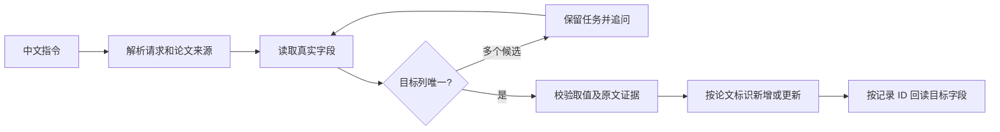

# 论文入表助手

用中文把论文存进飞书多维表格。助手先读取当前表的真实列名和类型，有多个候选列时主动追问，写入后再按记录 ID 回读核对；输入框支持切换模型，消息下方可实时查看工具调用、状态和耗时。也可以直接用内置的 SQLite 阅读清单体验完整流程。

**真实环境验证**：
- **论文录入与回读**：已在真实飞书测试表录入《Attention Is All You Need》（方法摘自第 3 节）和 BART。录入 BART 时从 PDF 第 2 页提取了 362 个字符的英文方法段并补入同一条记录，随后用飞书官方 CLI `base +record-get` 按记录 ID 回读，与原文和官网地址一致。[BART 原文第 2 页](https://aclanthology.org/2020.acl-main.703.pdf#page=2) · [Attention 原文第 3 节](https://arxiv.org/html/1706.03762#S3) · [Windows 与 Linux 自动测试](https://github.com/juyou4/paper-base-assistant/actions/workflows/test.yml)
- **字段与权限操作**：2026 年 11 月 18 日在同一测试表通过对话完成空文本列的新建、按字段 ID 查询、改名回读与删除（字段数 7 → 8 → 7，6 条已有记录的 ID 与其余字段定义未受影响）；协作者和高级角色变更通过本地示例与模拟官方 API 响应验收，未改动真实租户的人员权限。


## 从论文提取关键数据和图表

在工作台点 **批量提取数据与图表** 可预览 RAG 和 Transformer 两篇论文。也可在对话框输入自己的 arXiv 或 ACL Anthology 链接，每次最多 8 篇。

```text
提取这两篇论文的关键数据和图表
https://arxiv.org/abs/2005.11401v4
https://arxiv.org/abs/1706.03762v7
```

1. 展开某篇论文，核对指标的行名、列头、数值和目标列。比如在 Transformer 表 2 中，`28.4` 位于 `Transformer (big)` 行和 `BLEU / EN-DE` 列。可以沿出处链接查看原表，或点开架构图查看原图。[Transformer 表 2](https://arxiv.org/html/1706.03762v7#S6.T2)
2. 核对窗口会标出每篇将新增或更新的记录，以及对应字段。与提取项同名的文本列优先，其次使用指标或图表专列。在默认六列示例中，指标写入「阅读笔记」，图表摘录、原图地址和出处写入「研究笔记」。已有笔记后追加新内容。
3. 点 **确认回填** 后，服务端重新读取目标行、列和原值，再逐篇提交并按记录 ID 回读。点 **取消回填** 即结束该批次。提取失败、预览后目标发生变化或写入回执不一致时，可在逐篇结果中查看原因。

arXiv HTML 保留原表行列、图题和可用原图链接。PDF 可通过 Poppler 的 `pdftotext` 从前 32 页读取图题、表题和带量化结果的句子，出处链接定位到对应页。可选安装 `python -m pip install pdfplumber`，从候选页提取带网格线的表格，保留原始行列。仅有曲线或扫描图像时，可打开原页人工核对。两篇内置示例在官网不可用时可显示标注了版本与出处的预核摘录。确认和写表由服务端执行，这条提取流程可独立于语言模型运行。

## 用真实 Agent 操作飞书

准备一张自己可编辑的飞书测试表。登录飞书官方 CLI 后运行 `python tools/feishu_setup.py --mode cli`，按提示粘贴目标数据表的浏览器链接；推理使用本机已登录的官方 Codex CLI（需支持 `exec --ephemeral --ignore-user-config --output-schema`，可先用 `codex login status` 检查）：

```sh
python app.py --mode feishu-cli --agent codex --port 18972 --open
```

服务会在 `http://127.0.0.1:18972/` 启动工作台（Windows 也可直接双击 [start-feishu-agent.cmd](start-feishu-agent.cmd)）。可用 `--model 模型名` 指定初始模型；若装有多份 Codex，可用 `PAPER_CODEX_CLI` 指定可执行文件路径。

1. 在输入框底部选择模型（目录来自本机 Codex CLI），仅对当前浏览器会话生效。
2. 发送“看下这张表目前都有哪些列”。“执行过程”会实时展开飞书读取字段、Codex 识别意图、飞书查询字段定义三步（含工具名、状态和耗时），回复下方标出实际所用模型。
3. 发送“把 https://aclanthology.org/2020.acl-main.703/ 的标题、链接和中文摘要存进当前表”。助手提取作者摘要后由模型生成中文并复核，再写入飞书并按记录 ID 回读；接着发送“把刚才那篇的方法写进笔记”，可体验多笔记列的二次确认。
4. 点击表头“打开飞书表格”，刷新即可看到记录，双击列名或打开“分享 / 高级权限”可核对字段与权限配置。[查看飞书原生设置](docs/现场录屏.md)

Codex 运行在临时空目录的只读沙箱内，只接收当前指令、相关字段或论文片段；服务端校验模型返回的 JSON 后，由已登录的飞书 CLI 执行实际调用，确认按钮等确定性步骤也会在回复下方单独标注。[Codex 官方非交互模式说明](https://developers.openai.com/codex/noninteractive/)

实测在浏览器将模型从 `gpt-6.2-sol` 切到 `gpt-6.2-astra` 后查询真实飞书测试表，回复标注实际模型为 Astra 并返回 7 个字段（推理过程中可实时看到运行状态）；另用临时 SQLite 表验证了 BART 中文摘要生成、提交前原文复核及重开数据库后的逐字段回读。

## 运行

需要 Python 3.10 或以上版本。本地演示仅依赖 Python 标准库，无需 API Key。Windows 可双击 `start.cmd`，或在项目目录运行：

```sh
python app.py --open
```

访问 **http://127.0.0.1:8765**。表格与缓存保存在 `data/` 目录；如需另起空演示表，可运行 `python app.py --data-dir ./data/second-demo --port 8766 --open`。

## 试用

| 在对话框中输入 | 可以看到的结果 |
| --- | --- |
| 把 https://arxiv.org/abs/2005.11401 存进阅读清单 | 表格新增一行，标题和链接写入对应列。 |
| 把刚才那个也记进去 | 列出刚提到的论文和目标表，供选择存链接、填摘要、填方法、换一篇或取消。 |
| 给刚才那篇补一句方法概述 | 只更新同一行的方法列，并展示来源章节和原文短引。 |
| 把刚才那篇的方法写进笔记 | 列出“阅读笔记”和“研究笔记”，选择前不写入，选择后回读核对。 |
| 把「研究笔记」改成「需要复现」 | 询问是改整列名称还是填单条记录：改列预览结构变更，改记录则追问论文。 |
| 再存一次 https://arxiv.org/abs/2005.11401 | 提示相同内容已存在，表内仍保留一条记录。 |
| 下载刚才那篇论文 | 提供官网 PDF 供浏览器保存（首次下载需联网）。 |
| 新建文本列 审阅意见 | 展示目标表和新列名，确认后才修改表结构。 |

### 字段和权限怎么试

本地演示预置了虚拟协作者 `reader@example.test` 和自定义角色“论文审阅人”，可在对话框依次尝试：

| 示例 | 生效范围与确认 |
| --- | --- |
| 查看字段 | 查询字段列表；也可发送“查看字段「论文链接」”读取单列定义。 |
| 把字段「审阅意见」改名为「复核笔记」 | 展示原名、新名与该列已填记录数，确认后保留原有值改名。 |
| 把字段「复核笔记」的类型改为超链接 | 支持空文本列与超链接列互转；列内已有数据时提示处理现有值。 |
| 删除字段「复核笔记」 | 按精确列名或 ID 定位；若匹配多列则先选列再确认删除。 |
| 查看 reader@example.test 的协作者权限 | 查询该个人协作者在整份多维表格上的分享权限。 |
| 把 reader@example.test 的协作者权限改为可编辑 | 展示新旧权限（支持可查看、可编辑两档），确认后更新并回读。 |
| 查看角色「论文审阅人」的权限 | 显示该角色在当前数据表的表权限、记录范围和字段权限。 |
| 把角色「论文审阅人」对字段「研究笔记」的权限改为隐藏 | 仅调整目标列权限，其余列保持不变。 |
| 将角色「论文审阅人」的行权限改为全部可读、仅本人创建可编辑 | 展示新旧规则；另支持“全部记录可读写”和“仅可读写本人创建的记录”。 |

变更权限前程序会重新核对当前配置，若预览后已被他人改动则要求重新预览；并发修改时以飞书服务端回读为准。本地模式仅模拟配置变化，真实可见范围由飞书服务端控制。

飞书侧权限分为两层：
- **文档分享权限**：面向**整份多维表格**，需具备开放平台及文档协作者管理权限，仅调整已存在的个人协作者；用户身份下若按 Open ID 返回列表，需提供明确的 `ou_…`。[飞书协作者权限接口](https://open.feishu.cn/document/server-docs/docs/permission/permission-member/update)
- **高级角色权限**：面向**当前数据表**，需 Base 已开启高级权限、存在自定义角色且调用人有管理权限；按“本人创建”筛选还需可识别的创建人字段。程序会保留原有复杂规则，无法可靠修改时直接返回原因。[飞书官方角色更新实现](https://github.com/larksuite/cli/blob/v1.0.100/shortcuts/base/base_role_update.go)

换一篇论文可试“把 https://arxiv.org/abs/1706.03762 存进阅读清单”，再发送“给刚才那篇补英文原文摘要”（首次解析需联网）。普通网页链接可直接作为 URL 收藏；arXiv 和 ACL Anthology 支持提取题名、正文证据与 PDF 下载。

示例 RAG 论文的中文摘要和方法由作者预先对照原文整理，可离线使用；其余论文从页面或 PDF 读取（若本机装有 Poppler 的 `pdftotext`，会尝试读取 PDF 前 18 页并记录页码）。原文为英文时，可确认直接写入英文摘录，或配置模型生成带原文短引的中文概述；缺失方法章节时会提示缺少证据。[示例论文的原文](https://arxiv.org/html/2005.11401v4#S2)

## 连接自己的飞书测试表

先在飞书多维表格准备“论文标题”（文本）、“论文链接”（超链接）、“方法概述”（文本）等列，再建两个名称含“笔记”的文本列即可体验歧义确认。选中目标数据表后复制链接，下面两种方式任选其一：

**方式一：已登录的飞书官方 CLI**

安装并授权支持 `api` 子命令的官方 CLI 后运行：

```sh
python tools/feishu_setup.py --mode cli
python app.py --mode feishu-cli --open
```

若 CLI 不在 `PATH` 中，可将 `LARK_CLI` 指向可执行文件（Windows 可用官方 `lark-cli.exe`）。调用身份需拥有表格、字段和记录的读写权限，建列还需字段创建权限。[飞书官方 CLI](https://github.com/larksuite/cli)

**方式二：自建应用**

在进程环境中设置 `FEISHU_APP_ID` 与 `FEISHU_APP_SECRET`，为应用开通所需多维表格权限、发布生效并授予目标表编辑权，然后运行：

```sh
python tools/feishu_setup.py --mode app
python app.py --mode feishu --open
```

目标配置保存在 `data/feishu-target.json`（已忽略提交），也可用 `FEISHU_APP_TOKEN`、`FEISHU_TABLE_ID` 和 `FEISHU_TABLE_NAME` 直接指定。飞书模式下鉴权失败会直接报错，不会把失败操作记成本地成功。[开放平台新增记录接口](https://open.feishu.cn/document/server-docs/docs/bitable-v1/app-table-record/create)

## 可选语言模型

配置以下环境变量并重启服务，即可接入兼容 Chat Completions 的接口：

| 变量 | 说明 |
| --- | --- |
| `PAPER_MODEL_URL` | HTTPS 接口或本机模型地址（支持 `/v1` 结尾或完整 `/chat/completions` 路径）。 |
| `PAPER_MODEL_NAME` | 部署提供的模型名称。 |
| `PAPER_MODEL_KEY` | 服务商密钥，本机免鉴权服务可留空。 |
| `PAPER_MODEL_CHOICES` | 可选。服务支持的其他模型名，以英文逗号分隔，供输入框内切换。 |

启用模型后，单项字段管理与其余支持的口语指令由模型转为限定结构的意图，已识别的论文指令则由模型复核候选方案，最后统一由程序校验字段和笔记原话。生成中文摘要或方法时只发送相关原文片段，返回的引用须能在原文中逐字找到，并在界面一并展示出处。

### 提交前怎么核验

1. 生成写入草案后，按稳定字段 ID 重新读取列名和类型，核对论文标识与证据地址；原文摘录逐项对照论文段落，离线样例则与预置参考值及出处比对。
2. 对模型生成的中文概述另发一次审阅请求，检查结论、数字与变化方向是否有原文支撑并附逐字引文。任一环节缺材料、核验未通过或模型不可用时直接中止写入；界面保留证据链接供人工点开复核。
3. 草案通过后才写入，提交后按记录 ID 回读目标字段核对。结构或权限变更需先由用户确认计划，程序核对预览对象与原值后再提交回读。

## 实现和验证



- `workflow.py` 管理多轮对话状态、目标列选择与提交流程，各浏览器会话维护独立的待确认任务。
- `evidence_extract.py` 把原文整理为带出处的指标、表格和图。`evidence_workflow.py` 保存本次预览的字段与原值，按用户确认的批次提交和回读。
- `activity.py` 按会话和请求编号记录工具调用，供浏览器实时轮询进度并在失败时定位对应操作。
- `preflight.py` 负责提交前核验；`admin_dialog.py` 解析管理意图，字段、协作者与高级角色变更分别由 `schema_admin.py`、`collaborator_admin.py` 和 `role_admin.py` 处理。
- `papers.py`、`pdf_sections.py` 负责论文解析、PDF 下载和证据提取，同一 arXiv 编号的不同版本默认归入同一篇文章。
- `table_store.py` 封装 SQLite、飞书应用和飞书 CLI 三种后端；更新时仅提交本次要求的字段，业务查重拦截重复指令，原生飞书新增请求通过持久化的幂等令牌处理传输重试。
- `model_support.py` 与 `intent_model.py` 为可选的模型提取及意图识别入口，飞书令牌和模型密钥均留在服务端。

运行离线测试：

```sh
python -m unittest discover -s tests -v
```

测试覆盖字段歧义、确认与取消、同篇论文更新、模拟飞书回读及重试、模型输出校验、跨会话模型隔离，以及执行进度的实时读取和失败重试。本工具面向单机演示与个人阅读清单管理，默认绑定本机回环地址。
