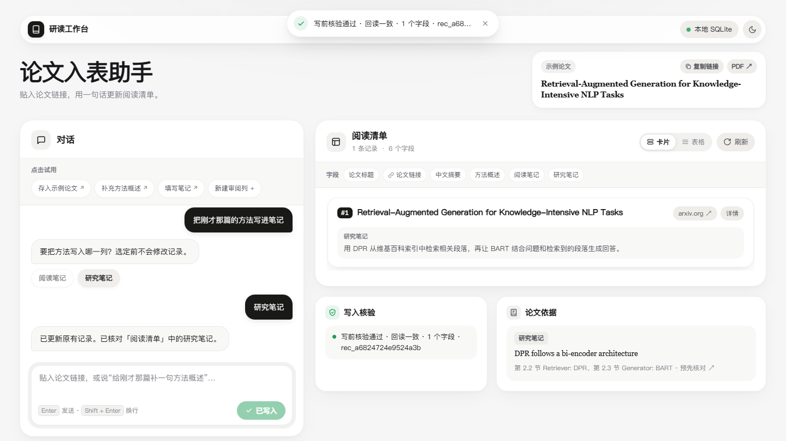
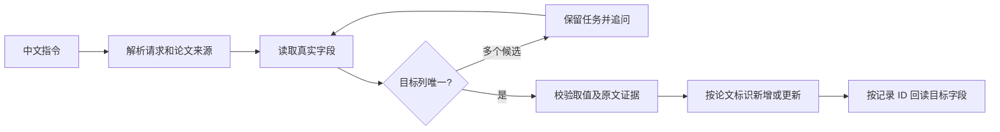

# 论文入表助手

用中文把论文存进飞书多维表格。助手先读取当前表的真实列名和类型，有多个候选列时主动追问，写入后再按记录 ID 回读核对；输入框支持切换模型，消息下方可实时查看工具调用、状态和耗时。也可以直接用内置的 SQLite 阅读清单体验完整流程。

本地模式默认把清单保存在项目的 `data/records.sqlite3`，其他本地数据表使用同一数据目录下的独立库。从同一路径启动即可继续阅读。已有记录默认显示“待读”。打开“详情”可标为“在读”或“已读”，给这条记录追加笔记、预览图表，或发送“补齐缺失的摘要和方法”。“导出清单”里的本地备份 JSON 包含整表字段、记录和本机阅读进度。

## 体验已有论文的研读流程

在项目目录运行以下命令，即可打开含两篇公开论文、四条带出处证据的独立示例清单。macOS 可将 `python` 换成 `python3`。示例保存在 `data/interview-demo/`，再次启动可继续使用自己补过的笔记和阅读进度。

```sh
python app.py --mode local --demo --agent rules --open
```

| 在对话框输入 | 可以现场核对什么 |
| --- | --- |
| 再看看 RAG | 打开已收藏的《Retrieval-Augmented Generation for Knowledge-Intensive NLP Tasks》，显示简称对应的题名原文。也可输入“再看看 attention”。 |
| 它的阅读笔记呢 | 按刚打开的记录 ID 重新读取对应列，可看到原文表格、指标及出处。“查看表中记录”可打开该行详情。 |
| 在我的清单里搜 指标 | 看哪些记录的笔记包含这个词。接着说“打开第二篇”，按屏幕上刚展示的顺序选择。 |
| 对比我收藏的《RAG》和《Attention》的关键数据和图表 | 并排查看两条记录已保存的指标、图题和原文链接。每个数字保留各自的数据集或评测名，缺项显示“未保存”。 |

清单上方的搜索框可即时筛选题名、简称、摘要和笔记，本地模式还可叠加阅读进度。对话中的简称来自可见题名本身。多篇匹配时先选记录，未找到时可以扩大到笔记或切换数据表。另开对话后可以重新按题名定位。要检索新的论文，可以明确说“去网上找几篇关于 attention 的论文”。

示例复用了批量提取后逐项确认的结果。RAG 保存了 Table 1 的 RAG-Seq. / NQ 数值 44.5，Attention 保存了 Table 2 的 Transformer (big) / EN-DE BLEU 数值 28.4，两篇各保存一张 Figure 1。要从零体验提取与提交，可用普通本地模式或已授权的飞书表。将两条论文链接和“提取这两篇的指标和图表”一起发出，在预览中逐篇勾选，再确认写入。

**真实环境验证**：
- **论文录入与回读**：已在真实飞书测试表录入《Attention Is All You Need》（方法摘自第 3 节）和 BART。录入 BART 时从 PDF 第 2 页提取了 362 个字符的英文方法段并补入同一条记录，随后用飞书官方 CLI `base +record-get` 按记录 ID 回读，与原文和官网地址一致。[BART 原文第 2 页](https://aclanthology.org/2020.acl-main.703.pdf#page=2) · [Attention 原文第 3 节](https://arxiv.org/html/1706.03762#S3)
- **字段与权限操作**：2026 年 11 月 18 日在同一测试表通过对话完成空文本列的新建、按字段 ID 查询、改名回读与删除（字段数 7 → 8 → 7，6 条已有记录的 ID 与其余字段定义未受影响）；协作者和高级角色变更通过本地示例与模拟官方 API 响应验收，未改动真实租户的人员权限。



## 续读、偏好与操作历史

打开对话区的“历史与记忆”。工作台将消息、阅读位置、表级偏好和操作回执写入当前数据目录的 `workspace-history.sqlite3`。同一个浏览器配置在相同工作台地址打开同一张表，可以重开上次的对话。不同浏览器身份和数据表各自保留历史。换设备或清除浏览器 Cookie 后会建立新的浏览器身份。

| 要做的事 | 操作 |
| --- | --- |
| 继续上次阅读 | 打开已收藏的论文，重开服务后问“它的阅读笔记呢”。助手重新读取当前表里的原记录，核对记录 ID、题名和链接。输入区显示当前论文，可清除。 |
| 查清助手写了什么 | 在“操作历史”中展开一次回填，查看逐篇结果、记录 ID、勾选的字段值和出处。预览、已核验、部分成功和待核验分别显示。历史从本版本启用后记录。 |
| 设置本表的默认目标列 | 发“记住：代码链接优先写入「研究笔记」”。列必须存在且可写。新证据预览会采用该偏好，确认前仍可手选其他列。也可在“记忆设置”里查看、关闭或删除。 |
| 管理对话和上下文 | 可新建、切换、删除或清空本表对话。设置里可分别开关保存新消息、重开时续读论文和使用本表偏好。清除对话后，已写的论文和操作回执可继续查阅。 |

恢复的聊天以文字展示。历史中的“确认”没有写入权限，需重新预览才能再次提交。模型按当次任务取得必要信息，保存的历史全文留在本机。

## 从不同来源收藏论文

**核对 PDF 和配套资源。** 在对话里输入“提取这篇的图表和代码仓库”并附上会议论文链接。核对窗中的 PDF 证据可以展开对应原页，也可以打开出处。安装 `python -m pip install pdfplumber pypdfium2 Pillow` 即可在本机显示页图。原页视图仅对当前会话待确认的批次开放。GitHub、GitLab 和 Hugging Face 资源使用论文里实际出现的地址，展示上下文和出处，默认不勾选。读者可指定代码、模型或数据集链接，核对归属后写入可用文本列，保留引句和论文页码。写入已有“研究笔记”后还可以问“它的代码链接呢”。

PDF 中的坐标轴有时会被解析成网格。遇到找不到对应表题、表头残缺或行列归属不清的网格，预览会标出“需核对原页”，默认取消勾选，也不从中提取独立指标。直接回复“确认”会跳过这些项。打开原页后可以手动勾选要保存的表格。

从 CVF 或 ACL Anthology 的官方入口成功提取后，工作台会把题录和实际使用的 PDF 指纹保存在本机。下次通过同一入口提取时，若官网题录暂时读不到，工作台会核对本机文件并重新解析，标明“此前保存的会议版本”。首次读取仍需要官网全文或用户关联的 PDF。

**把收藏带进组会。** 在任一工作台点“选择对照”，按展示顺序选择 2 至 4 篇。切换卡片、表格或临时筛选后仍保留选择。“打开对照”读取各行现有的摘要、方法、关键数据、图表、公式、资源链接和笔记。“复制 Markdown”保留题名、原文地址、数据和缺项，也支持对话生成的对照。

**导出文献。** 在“导出清单”选择 BibTeX、RIS、CSV 或 Markdown，作用范围是当前表的可见记录；单篇可在“详情”里复制 BibTeX。引用优先使用行上填写的作者、年份和出版信息，再采用绑定到该论文的已存题录。已知会议和期刊分别按对应类型输出，缺少类型时使用通用条目，缺少作者或年份会提示。

**跨来源实测。** 在真实飞书测试表中，RAG 的 arXiv 论文和 DenseNet 的 CVPR 论文各选了一个指标和一张图。确认前表中始终为 10 行，确认后为 12 行，按两个记录 ID 回读四项内容和原文定位，原有 10 行逐字段一致。DenseNet 的错误率原句保留了 C10+、C100+ 两个实验条件，可从预览查看原页。[RAG 原文](https://arxiv.org/abs/2005.11401v4) · [DenseNet 会议原文](https://openaccess.thecvf.com/content_cvpr_2017/html/Huang_Densely_Connected_Convolutional_CVPR_2017_paper.html)

把组会里收到的链接或 DOI 分行粘进对话框，加一句“这几篇都先收着”。每批最多 8 个来源。收录卡显示可取得的题名、作者、年份、来源入口和全文状态。只记得英文题名时可以说“帮我收藏 Deep Residual Learning for Image Recognition”，从 Crossref 候选中选出要读的一篇。

想先找论文，可以说“搜索《Deep Residual Learning for Image Recognition》”或“找几篇关于 retrieval augmented generation 的论文”。助手用题名关键词查询 Crossref，展示最多三个候选题录及来源。说“看看第二篇”可以核对候选，说“收藏第二篇”才会写入当前表。查询自己的清单可以问“我现在收藏了几篇论文”“表里存了什么”或“论文链接这一栏是什么类型”；也可以用“我之前收藏过《完整题名》吗”在表内核对。

| 想做的事 | 可以这样问 | 助手会怎样处理 |
| --- | --- | --- |
| 找以前读过的论文 | 在我收藏的论文里搜一下 Transformer | 在当前表可识别的标题、摘要、方法和笔记列里匹配关键词，显示命中的列及摘要或笔记片段。支持英文大小写和全角字符。 |
| 去网上找文献 | 去网上找几篇关于知识蒸馏的论文 | 只把检索词交给 Crossref，展示可能的论文和来源链接。 |
| 还没说清查哪里 | 帮我找找 Transformer 的论文 | 先让你选阅读清单或公开题录。可以点按钮，也可以接着说“只看我收藏的”或“去网上看看吧”。 |

| 手上的材料 | 在工作台里的用法 |
| --- | --- |
| arXiv、ACL、CVPR 等 CVF 会议页或其官方 PDF | 收藏官网题录，取得公开全文后可提取证据。CVF 与 Crossref 的跨站匹配会核对题名、作者顺序、会议和年份。 |
| DOI、IEEE Xplore、OpenReview、带 DOI 的 ACM 和 Springer 出版页面 | 从已确认的出版记录和公开论文入口查找题录及原文。遇到限流、订阅限制或缺少全文时保留已知来源，可以稍后补 PDF。 |
| 同事发来的 PDF、自己下载的订阅全文 | 拖入对话框或使用附件按钮，核对首页候选标识，选择已有记录或填写论文链接和题名。缺少标识的文件可先保留为待关联。添加和关联均可在写表前完成。 |

已核实属于同一出版记录的入口会归到同一行。可问“查看刚才那篇的来源链接”。“给第二篇记一句：周五复现表二”指向刚才显示的第二张论文卡片，笔记按原话追加。预印本和出版版只有题名相似时各自保留记录。已有行固定为 arXiv v1 时，再收藏 v2 会保留两个版本入口；来自 v2 的摘要或方法写入前会提示版本冲突。

本地 PDF 每份上限 50 MB，校验文件需要 pdfplumber 或 Poppler。附件按浏览器会话保存在本机，原页可在确认窗口内打开。回填内容带出版入口、页码和文件 SHA-256，方便核对使用的副本。

## 从论文提取关键数据和图表

在工作台点 **批量提取数据图表** 可并发预览 RAG 和 Transformer 两篇论文。也可混合发送不同来源的论文链接和 DOI，或使用已关联的 PDF。多篇批次并发抓取解析并保留原顺序，每篇单独显示提取结果和缺少全文的原因。

也可以分两句说。先发论文链接，再问“这两篇跑分怎么样？”；已有论文上下文时，可以问“刚才那篇有啥图？”或“帮我看看刚才那篇的实验表格”。核对窗口会展示相应类型的原文证据。遇到字段追问，像“就放阅读笔记吧”“我选第二个”这样的回答也可以识别。

同一批里可以分开指定提取内容，例如“第一篇只看架构图，第二篇只看实验数据”。预览后说“只留最后一篇”或“去掉公式”，助手会重新展示待回填内容。更改范围后要确认新版预览。服务运行期间，在同一浏览器标签页刷新，能继续核对这批内容、先前的勾选项和写入列配置。

```text
提取这两篇论文的关键数据和图表
https://arxiv.org/abs/2005.11401v4
https://arxiv.org/abs/1706.03762v7
```

1. 通过弹窗顶部的多篇标签栏切换论文，核对每篇已选数量、新增/更新动作，以及指标的行名、列头、数值和原图。比如在 Transformer 表 2 中，`28.4` 位于 `Transformer (big)` 行和 `BLEU / EN-DE` 列，单表最多展示 4 项标量指标、每篇最多 3 张图。可以沿出处链接查看原表，或点开架构图查看原图。[Transformer 表 2](https://arxiv.org/html/1706.03762v7#S6.T2)
2. 弹窗内会标出每篇将新增或更新的记录及默认写入列，也支持按数据、表格、图片、公式分类在当前表的可写文本列中直接改选目标列。与提取项同名的文本列优先，其次使用「关键数据」「关键图表」「论文公式」等专列；在默认六列示例中，指标写入「阅读笔记」，图表摘录、原图地址和出处写入「研究笔记」，已有内容后追加。
3. 勾选要保留的条目，也可以取消整篇。点 **确认写入** 后，服务端重新校验目标行、目标列（含弹窗改选列）和原值，只提交选中项，再按记录 ID 回读核验。若原本准备新增的论文已出现在表内，则提示重新预览。点 **取消** 即结束该批次。提取失败或回读不一致时，可在逐篇结果中查看原因。

arXiv HTML 保留原表行列、图题和可用原图链接。PDF 可通过 Poppler 的 `pdftotext` 从前 32 页读取图题、表题和带量化结果的句子，出处链接定位到对应页。安装 `python -m pip install pdfplumber` 后还可识别网格表，以及表题上方列头和数字清晰对齐的无框表。实际用 ResNet 的 CVF 录用稿在浏览器中验证，表 2 中 34 层普通网络和 ResNet 的 ImageNet 验证集 Top-1 错误率分别为 28.54% 和 25.03%。仅勾选这两项后，临时 SQLite 表在原记录中只追加了这两个指标。扫描图像和复杂公式可打开原页人工核对。两篇内置示例在官网不可用时可显示标注了版本与出处的预核摘录。[ResNet 原文第 5 页](https://openaccess.thecvf.com/content_cvpr_2016/papers/He_Deep_Residual_Learning_CVPR_2016_paper.pdf#page=5)

### 核对数学公式

发送“看看 https://arxiv.org/abs/2005.11401v4 里的公式”，有论文上下文时也可以直接说“刚才那篇只看方程”。核对卡片会排版分式、根号、上下标和多行方程，提供 LaTeX 源码和原文定位。预览 RAG 时，可以打开出处核对 RAG-Sequence 和 RAG-Token 两种概率表达式中求和、连乘符号的先后顺序。[RAG 原文公式](https://arxiv.org/html/2005.11401v4#S2.Ex1)

公式取自 arXiv HTML 的数学节点或正文里的 Markdown 数学标记。助手保留原文提供的 TeX，每篇最多展示 8 项，优先展示独立公式。代码块和价格中的美元符号按普通文本处理。扫描 PDF 的数学 OCR 尚未接入。浏览器所用的数学字体、KaTeX 和 Markdown 解析器随仓库提供。

确认后，助手优先回填「论文公式」「关键公式」或「公式」文本列，其次寻找「研究笔记」「阅读笔记」。飞书单元格保存带数学定界符的 LaTeX 和出处 URL，工作台显示排版效果。再次提取同一项时会核对已有内容。

## 用真实 Agent 操作飞书

在新电脑上可以先安装 Python 3.11 或 3.12 和 Node.js 22。以下版本已在 Windows 验证。在终端依次运行，各自在浏览器完成登录或授权。已经配好飞书应用的电脑可跳过 `lark-cli config init`。

```sh
npm install -g "@openai/codex@0.170.0" "@larksuite/cli@1.0.100"
codex login
codex login status
lark-cli config init
lark-cli auth login --domain base
```

要从空工作区开始，在项目目录运行 `python app.py --mode feishu-cli --agent codex --data-dir data/fresh --open`，然后说“新建多维表格「论文资料库」”。先体验本地清单可用 `python app.py --mode local --agent codex --open`。macOS 上可以将命令中的 `python` 替换为 `python3`。以下流程适用于已有飞书表格的情况。

准备一张自己可编辑的飞书测试表。登录飞书官方 CLI 后运行 `python tools/feishu_setup.py --mode cli`，按提示粘贴目标数据表的浏览器链接；推理使用本机已登录的官方 Codex CLI（需支持 `exec --ephemeral --ignore-user-config --output-schema`，可先用 `codex login status` 检查）：

```sh
python app.py --mode feishu-cli --agent codex --port 18972 --open
```

服务会在 `http://127.0.0.1:18972/` 启动工作台（Windows 也可直接双击 [start-feishu-agent.cmd](start-feishu-agent.cmd)）。可用 `--model 模型名` 指定初始模型；若装有多份 Codex，可用 `PAPER_CODEX_CLI` 指定可执行文件路径。

1. 在输入框底部选择模型（目录来自本机 Codex CLI），仅对当前浏览器会话生效。
2. 发送“看下这张表目前都有哪些列”。“执行过程”会实时展开飞书读取字段、Codex 识别意图、飞书查询字段定义三步（含工具名、状态和耗时），回复下方标出实际所用模型。
3. 发送“把 https://aclanthology.org/2020.acl-main.703/ 的标题、链接和中文摘要存进当前表”。助手提取作者摘要后由模型生成中文并复核，再写入飞书并按记录 ID 回读；接着发送“把刚才那篇的方法写进笔记”，可体验多笔记列的二次确认。
4. 点击表头“打开飞书表格”，刷新即可看到记录，双击列名或打开“分享 / 高级权限”可核对字段与权限配置。[查看飞书原生设置](docs/现场录屏.md)

Codex 运行在临时空目录的只读沙箱内，只接收当前指令、相关字段或论文片段；服务端校验模型返回的 JSON 后，由已登录的飞书 CLI 执行实际调用，确认按钮等确定性步骤也会在回复下方单独标注。[Codex 官方非交互模式说明](https://developers.openai.com/codex/noninteractive/)

实测在浏览器将模型从 `gpt-6.2-sol` 切到 `gpt-6.2-astra` 后查询真实飞书测试表，回复标注实际模型为 Astra 并返回 7 个字段（推理过程中可实时看到运行状态）；另用临时 SQLite 表验证了 BART 中文摘要生成、提交前原文复核及重开数据库后的逐字段回读。

## 运行

需要 Python 3.10 或以上版本。内置样例与 SQLite 阅读清单可直接用 Python 标准库运行，无需 API Key。要使用本地 PDF 和无框表格提取，可先执行 `python -m pip install pdfplumber`。Windows 可双击 `start.cmd`，或在项目目录运行：

```sh
python app.py --open
```

访问 **http://127.0.0.1:8765**。表格与缓存保存在 `data/` 目录；如需另起空演示表，可运行 `python app.py --data-dir ./data/second-demo --port 8766 --open`。

## 试用

| 在对话框中输入 | 可以看到的结果 |
| --- | --- |
| 查一下表 | 读取当前连接的表，显示可见记录数、字段和最多五条非空记录预览。 |
| 这张表有几条记录？ | 返回可见记录数。预览论文过程中也能插问，原来的确认仍然有效。 |
| 看看刚才那篇论文里的表 | 提取论文原表，展示行列和来源，等待核对。 |
| 把 https://arxiv.org/abs/2005.11401 存进阅读清单 | 表格新增一行，标题和链接写入对应列。 |
| 把刚才那个也记进去 | 列出刚提到的论文和目标表，供选择存链接、填摘要、填方法、换一篇或取消。 |
| 给刚才那篇补一句方法概述 | 只更新同一行的方法列，并展示来源章节和原文短引。 |
| 把刚才那篇的方法写进笔记 | 列出“阅读笔记”和“研究笔记”，选择前不写入，选择后回读核对。 |
| 把「研究笔记」改成「需要复现」 | 询问是改整列名称还是填单条记录：改列预览结构变更，改记录则追问论文。 |
| 再存一次 https://arxiv.org/abs/2005.11401 | 提示相同内容已存在，表内仍保留一条记录。 |
| 下载刚才那篇论文 | 提供官网 PDF 供浏览器保存（首次下载需联网）。 |
| 新建文本列 审阅意见 | 展示目标表和新列名，确认后才修改表结构。 |

### 字段和权限怎么试

本地演示预置了虚拟协作者 `reader@example.test` 和自定义角色“论文审阅人”，可在对话框依次尝试：

| 示例 | 生效范围与确认 |
| --- | --- |
| 查看字段 | 查询字段列表；也可发送“查看字段「论文链接」”读取单列定义。 |
| 把字段「审阅意见」改名为「复核笔记」 | 展示原名、新名与该列已填记录数，确认后保留原有值改名。 |
| 把字段「复核笔记」的类型改为超链接 | 支持空文本列与超链接列互转；列内已有数据时提示处理现有值。 |
| 删除字段「复核笔记」 | 按精确列名或 ID 定位；若匹配多列则先选列再确认删除。 |
| 查看 reader@example.test 的协作者权限 | 查询该个人协作者在整份多维表格上的分享权限。 |
| 把 reader@example.test 的协作者权限改为可编辑 | 展示新旧权限（支持可查看、可编辑两档），确认后更新并回读。 |
| 查看角色「论文审阅人」的权限 | 显示该角色在当前数据表的表权限、记录范围和字段权限。 |
| 把角色「论文审阅人」对字段「研究笔记」的权限改为隐藏 | 仅调整目标列权限，其余列保持不变。 |
| 将角色「论文审阅人」的行权限改为全部可读、仅本人创建可编辑 | 展示新旧规则；另支持“全部记录可读写”和“仅可读写本人创建的记录”。 |

变更权限前程序会重新核对当前配置，若预览后已被他人改动则要求重新预览；并发修改时以飞书服务端回读为准。本地模式仅模拟配置变化，真实可见范围由飞书服务端控制。

飞书侧权限分为两层：
- **文档分享权限**：面向**整份多维表格**，需具备开放平台及文档协作者管理权限，仅调整已存在的个人协作者；用户身份下若按 Open ID 返回列表，需提供明确的 `ou_…`。[飞书协作者权限接口](https://open.feishu.cn/document/server-docs/docs/permission/permission-member/update)
- **高级角色权限**：面向**当前数据表**，需 Base 已开启高级权限、存在自定义角色且调用人有管理权限；按“本人创建”筛选还需可识别的创建人字段。程序会保留原有复杂规则，无法可靠修改时直接返回原因。[飞书官方角色更新实现](https://github.com/larksuite/cli/blob/v1.0.100/shortcuts/base/base_role_update.go)

换一篇论文可试“把 https://arxiv.org/abs/1706.03762 存进阅读清单”，再发送“给刚才那篇补英文原文摘要”（首次解析需联网）。其他网页也可保存为来源链接。

示例 RAG 论文的中文摘要和方法由作者预先对照原文整理，可离线使用；其余论文从页面或 PDF 读取（若本机装有 Poppler 的 `pdftotext`，会尝试读取 PDF 前 18 页并记录页码）。原文为英文时，可确认直接写入英文摘录，或配置模型生成带原文短引的中文概述；缺失方法章节时会提示缺少证据。[示例论文的原文](https://arxiv.org/html/2005.11401v4#S2)

## 连接自己的飞书测试表

先在飞书多维表格准备“论文标题”（文本）、“论文链接”（超链接）、“方法概述”（文本）等列，再建两个名称含“笔记”的文本列即可体验歧义确认。选中目标数据表后复制链接，下面两种方式任选其一：

**方式一：已登录的飞书官方 CLI**

安装并授权支持 `api` 子命令的官方 CLI 后运行：

```sh
python tools/feishu_setup.py --mode cli
python app.py --mode feishu-cli --open
```

若 CLI 不在 `PATH` 中，可将 `LARK_CLI` 指向可执行文件（Windows 可用官方 `lark-cli.exe`）。调用身份需拥有表格、字段和记录的读写权限，建列还需字段创建权限。[飞书官方 CLI](https://github.com/larksuite/cli)

**方式二：自建应用**

在进程环境中设置 `FEISHU_APP_ID` 与 `FEISHU_APP_SECRET`，为应用开通所需多维表格权限、发布生效并授予目标表编辑权，然后运行：

```sh
python tools/feishu_setup.py --mode app
python app.py --mode feishu --open
```

目标配置保存在 `data/feishu-target.json`（已忽略提交），也可用 `FEISHU_APP_TOKEN`、`FEISHU_TABLE_ID` 和 `FEISHU_TABLE_NAME` 直接指定。飞书模式下鉴权失败会直接报错，不会把失败操作记成本地成功。[开放平台新增记录接口](https://open.feishu.cn/document/server-docs/docs/bitable-v1/app-table-record/create)

## 在对话中创建多维表格和字段

已有飞书多维表格链接时，可以按上一节绑定，然后在文件里增加数据表。首次使用也可以直接从空工作区开始。以已授权的飞书 CLI 为例，确保 `FEISHU_APP_TOKEN` 和 `FEISHU_TABLE_ID` 都未设置，指定一个没有 `feishu-target.json` 的数据目录即可启动：

```sh
python app.py --mode feishu-cli --data-dir data/fresh --open
```

首页会显示“尚未选择数据表”。使用自建应用时，将命令中的 `feishu-cli` 换成 `feishu`，并按上一节配置应用身份。两种启动方式均可直接在对话中创建第一份文件。

| 想做什么 | 可直接输入的示例 | 确认后会发生什么 |
| --- | --- | --- |
| 创建独立文件，自己指定字段 | 请帮我新建一个独立的飞书多维表格「论文资料库」，首张表叫「实验结果」，字段：论文标题（文本）、论文链接（超链接）、准确率（文本） | 点“确认新建多维表格”。助手创建文件和工作表，回读字段，并给出新工作表的飞书链接。 |
| 在当前文件里建另一张表，让助手设计字段 | 新建数据表「模型对比」，字段你来设计，用于记录模型、数据集和评价指标 | 先预览“论文标题、论文链接、模型、数据集、评价指标”五列。点“确认新建数据表”后创建，并切换到“模型对比”。 |

预览会列出新表的位置、表名和每一列的类型。当前建表支持文本与超链接，第一列为文本主字段。用途里已经列出的维度可以直接生成字段。对于“判断下周应该优先复现哪篇论文”这类开放用途，接入的模型可以提议字段。模型不可用或提议未通过校验时，助手会请你补充。在预览里可以接着说“再加一列代码链接”“去掉研究笔记这列”或“把表名改成候选”。调整仅作用于待建方案，新的确认按钮会对应调整后的方案。

建表后的收藏、笔记和数据回填都使用当前对话选中的数据表。说“列出所有数据表”可查看当前文件的目录，说“切换到数据表「实验结果」”可切换回另一张工作表。若启动时已绑定表，也可说“切回初始表”。切换只对当前会话生效。

飞书可能随新文件附送一张空白默认表，助手会保留它。如果它与指定工作表同名，助手会先核对该默认表的身份和内容；仅当内容为空时，将默认表改名，再创建指定工作表。CLI 使用当前登录用户的权限，自建应用使用应用身份。创建文件、在文件内建表和读取表结构分别需要相应权限；同名默认表的改名还需要更新数据表的权限。自建应用创建的文件按飞书协作规则共享，接收者打开链接时需要具备访问权。[飞书创建多维表格接口](https://open.feishu.cn/document/server-docs/docs/bitable-v1/app/create) · [飞书新增数据表接口](https://open.feishu.cn/document/server-docs/docs/bitable-v1/app-table/create)

## 可选语言模型

官方 Codex CLI 使用本机已登录的账号。接第三方模型时可在启动进程配置以下环境变量，然后执行 `python app.py --mode feishu-cli --agent compatible --port 18973 --open`。对话里的模型选择器会列出这次启动所用服务的可选模型。

| 变量 | 说明 |
| --- | --- |
| `PAPER_MODEL_URL` | HTTPS 接口或本机模型地址（支持 `/v1` 结尾或完整 `/chat/completions` 路径）。 |
| `PAPER_MODEL_NAME` | 部署提供的模型名称。 |
| `PAPER_MODEL_KEY` | 服务商密钥，本机免鉴权服务可留空。 |
| `PAPER_MODEL_CHOICES` | 可选。服务支持的其他模型名，以英文逗号分隔，供输入框内切换。 |

启用模型后，单项字段管理与其余支持的口语指令由模型转为限定结构的意图，已识别的论文指令则由模型复核候选方案，最后统一由程序校验字段和笔记原话。生成中文摘要或方法时只发送相关原文片段，返回的引用须能在原文中逐字找到，并在界面一并展示出处。

复杂检索表达最多调用一次检索分类模型。模型给出的关键词须能在用户原话中找到，检索范围也要与原话相符。模型没有识别出主题时，助手会请用户补充。查表能显示哪一列命中；表内搜索按关键词匹配，不进行全文语义检索。管理字段时会核对完整列名、新列名和当前表结构。模型返回的目标列、下载动作或输出语言与原话不符时会停止写入。模型调用失败也会出现在本轮工具记录中。

在数据与图表流程中，程序直接处理常见的口语表达。需要语义判断时，模型建议要预览哪些指标、图、表或公式，服务端从用户给出的链接或当前对话定位论文。目标记录、确认批次和最终写入均由服务端核对。

### 提交前怎么核验

1. 生成写入草案后，按稳定字段 ID 重新读取列名和类型，核对论文标识与证据地址；原文摘录逐项对照论文段落，离线样例则与预置参考值及出处比对。
2. 对模型生成的中文概述另发一次审阅请求，检查结论、数字与变化方向是否有原文支撑并附逐字引文。任一环节缺材料、核验未通过或模型不可用时直接中止写入；界面保留证据链接供人工点开复核。
3. 草案通过后才写入，提交后按记录 ID 回读目标字段核对。结构或权限变更需先由用户确认计划，程序核对预览对象与原值后再提交回读。

单篇补写还会在提交前和回读时核对这条记录的论文身份。若有人把原行的论文链接换成了另一篇、清空了可核对的标识，或同一链接出现在多条记录中，助手会提示核对目标行。同一 arXiv 编号的摘要页和 PDF 链接可以正常匹配。

## 实现和验证



- `workflow.py` 管理多轮对话状态、目标列选择与提交流程，各浏览器会话维护独立的待确认任务；`intent_guard.py` 与 `paper_selection.py` 负责论文写表意图边界与序号定位。
- `evidence_extract.py` 把原文整理为带出处的指标、表格和图，`math_evidence.py` 读取数学源码、编号和出处。`evidence_workflow.py` 支持多篇并发提取、预览内自定义目标列校验，以及按用户确认批次提交与回读。
- `base_files.py`、`base_table_dialog.py`、`workspace_actions.py` 处理多维表格与数据表的创建、字段规划及会话内切表；`library_search.py`、`library_search_intent.py`、`paper_search_dialog.py` 负责表内检索与 Crossref 公开题录搜索。
- `title_aliases.py` 从题名生成可追溯的简称。`saved_paper_dialog.py` 和 `saved_focus.py` 按当前表与记录 ID 回读单篇，`saved_compare.py` 按两篇记录的实际字段生成并排对照。
- `activity.py` 按会话和请求编号记录工具调用，供浏览器实时轮询进度并在失败时定位对应操作。
- `preflight.py` 负责提交前核验；`admin_dialog.py` 解析管理意图，字段、协作者与高级角色变更分别由 `schema_admin.py`、`collaborator_admin.py` 和 `role_admin.py` 处理。
- `papers.py`、`pdf_sections.py`、`paper_attachments.py` 负责论文解析、PDF 下载、本地附件关联和证据提取，同一 arXiv 编号的不同版本默认归入同一篇文章。
- `table_store.py` 封装 SQLite、飞书应用和飞书 CLI 三种后端；更新时仅提交本次要求的字段，业务查重拦截重复指令，原生飞书新增请求通过持久化的幂等令牌处理传输重试。
- `model_support.py` 与 `intent_model.py` 为可选的模型提取及意图识别入口，飞书令牌和模型密钥均留在服务端。

本工具面向单机演示与个人阅读清单管理，默认绑定本机回环地址。
