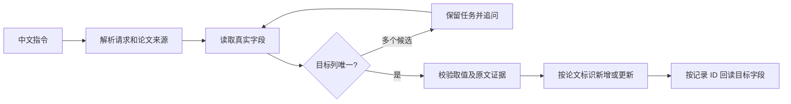

# 论文入表助手

用中文把论文存进飞书多维表格。助手会先读取当前表的真实列名和类型，遇到多个候选列时主动追问，写入后再按记录 ID 回读核对。对话输入框支持切换模型，消息下方可以实时查看工具、执行状态和耗时。也可以用内置的 SQLite 阅读清单直接体验完整对话流程。

在真实飞书测试表中，目前已录入两篇非内置论文：《Attention Is All You Need》（方法摘自第 3 节）和 BART。录入 BART 时，助手从 PDF 第 2 页提取了 362 个字符的英文方法段并补入同一条记录；随后独立运行飞书官方 CLI 的 `base +record-get` 按记录 ID 回读，核对了正式题名、官网链接以及 PDF 原文段落。[BART 原文第 2 页](https://aclanthology.org/2020.acl-main.703.pdf#page=2) · [Attention 原文第 3 节](https://arxiv.org/html/1706.03762#S3) · [Windows 与 Linux 自动测试](https://github.com/juyou4/paper-base-assistant/actions/workflows/test.yml)

2026 年 11 月 18 日还在同一测试表实测了字段的增删改查：通过对话新建空文本列、查询其字段 ID、确认改名并回读，最后按同一 ID 删除。全过程字段数由 7 变为 8 再回到 7，原有的 6 条记录 ID 与其余字段定义均保持不变。协作者与高级角色权限变更则通过本地示例及模拟官方 API 响应完成验收，保留了真实租户的原有人员权限。


## 用真实 Agent 操作飞书

准备一张自己拥有编辑权限的飞书测试表。登录飞书官方 CLI 后，运行 `python tools/feishu_setup.py --mode cli`，按提示粘贴选中目标数据表后的浏览器链接。推理模型使用本机已登录的官方 Codex CLI（需支持 `exec --ephemeral --ignore-user-config --output-schema`，可先用 `codex login status` 检查登录状态）：

```sh
python app.py --mode feishu-cli --agent codex --port 18972 --open
```

命令会在本机 `http://127.0.0.1:18972/` 启动工作台。Windows 用户也可以双击 [start-feishu-agent.cmd](start-feishu-agent.cmd)。可通过 `--model 模型名` 指定初始模型；若本机装有多份 Codex，可将 `PAPER_CODEX_CLI` 指向目标可执行文件。

1. 点击输入框底部的模型名，从本机 Codex CLI 返回的模型目录中选择。这个选择只对当前浏览器会话生效，下一条需要推理的指令会用所选模型。
2. 输入“看下这张表目前都有哪些列”。发送后，“执行过程”会自动展开，依次显示飞书读取字段、Codex 识别意图、飞书查询字段定义。每项都有工具名、状态和耗时，结束后仍可展开查看。回复下方会列出本次实际使用的模型。
3. 输入“把 https://aclanthology.org/2020.acl-main.703/ 的标题、链接和中文摘要存进当前表”。助手读取作者摘要，调用模型生成中文并单独复核，再向飞书提交、按记录 ID 回读。接着输入“把刚才那篇的方法写进笔记”，即可在有多个笔记列时体验二次确认。
4. 点击表头的“打开飞书表格”，刷新后找到同一篇论文。双击列名可以查看字段类型，打开“分享”或“高级权限”可以核对当前配置。[查看飞书原生设置](docs/现场录屏.md)

每次请求都会在回复下方标明已完成的模型步骤，点击确认按钮等确定性操作也会如实标注。Codex 运行在临时空目录和只读沙箱中，仅接收当前指令、相关字段或论文片段；服务端校验模型返回的 JSON 后，由已登录的飞书 CLI 执行实际的飞书调用。[Codex 官方非交互模式说明](https://developers.openai.com/codex/noninteractive/)

实测从 `gpt-6.2-sol` 切到 `gpt-6.2-astra` 后查询真实飞书测试表，回复显示本次使用 Astra，返回了 7 个字段。另用临时 SQLite 表验证了 BART 中文摘要生成、提交前原文复核及重新打开数据库后的逐字段回读。模型推理仍在进行时，浏览器已经能看到该步骤的运行状态。

## 运行

需要 Python 3.10 或以上版本。本地演示仅使用 Python 标准库，无需 API Key。Windows 可双击 `start.cmd`，或在项目目录执行：

```sh
python app.py --open
```

随后打开 **http://127.0.0.1:8765**。表格数据和下载缓存保存在 `data/`，关闭窗口后仍会保留。如需另起一张空的本地演示表，可运行 `python app.py --data-dir ./data/second-demo --port 8766 --open`。

## 试用

| 在对话框中输入 | 可以看到的结果 |
| --- | --- |
| 把 https://arxiv.org/abs/2005.11401 存进阅读清单 | 表格新增一行，标题和链接写入对应列。 |
| 把刚才那个也记进去 | 助手列出刚提到的论文和目标表，供选择存链接、填摘要、填方法、换一篇或取消。 |
| 给刚才那篇补一句方法概述 | 只更新同一行的方法列，并展示来源章节和原文短引。 |
| 把刚才那篇的方法写进笔记 | 助手列出“阅读笔记”和“研究笔记”，选择前不写入，选择后回读核对。 |
| 把「研究笔记」改成「需要复现」 | 助手询问是修改整列名称还是填写单条记录：改列会预览结构变更，改记录会追问论文。 |
| 再存一次 https://arxiv.org/abs/2005.11401 | 提示相同内容已存在，表内仍保留一条记录。 |
| 下载刚才那篇论文 | 提供来自官网的 PDF 供浏览器保存（首次下载需要联网）。 |
| 新建文本列 审阅意见 | 展示目标表和新列名，确认建列后才修改表结构。 |

### 字段和权限怎么试

本地演示预置了虚拟协作者 `reader@example.test` 与自定义角色“论文审阅人”。可在同一个对话框依次输入以下指令：

| 示例 | 生效范围与确认 |
| --- | --- |
| 查看字段 | 查询字段列表；也可发送“查看字段「论文链接」”读取单列定义。 |
| 把字段「审阅意见」改名为「复核笔记」 | 先展示原名、新名及该列已填记录数，确认后保留原有值完成改名。 |
| 把字段「复核笔记」的类型改为超链接 | 支持空文本列与超链接列互转；列内已有数据时提示处理现有值。 |
| 删除字段「复核笔记」 | 按精确列名或 ID 定位；若输入“删除字段笔记”匹配多列，则先选列再确认删除。 |
| 查看 reader@example.test 的协作者权限 | 查询该个人协作者在整份多维表格上的分享权限。 |
| 把 reader@example.test 的协作者权限改为可编辑 | 展示原权限与拟授予权限，确认后更新并回读（支持可查看、可编辑两档）。 |
| 查看角色「论文审阅人」的权限 | 显示该角色在当前数据表的表权限、记录范围和字段权限。 |
| 把角色「论文审阅人」对字段「研究笔记」的权限改为隐藏 | 仅调整目标列权限，其余列保持原配置。 |
| 将角色「论文审阅人」的行权限改为全部可读、仅本人创建可编辑 | 展示受影响角色与新旧规则；另支持“全部记录可读写”和“仅可读写本人创建的记录”。 |

变更权限前，程序会重新读取授权对象和当前权限；若预览期间权限已被他人修改，会提示重新生成预览。并发修改同一云文档时，飞书接口的最终状态以服务端回读为准。本地示例仅模拟权限配置变化，实际账号能看到哪些行和列由飞书服务端执行授权规则。

飞书侧的权限规则分为两层：
- **文档分享权限**：面向**整份多维表格**，调用人需具备开放平台权限及该文档的协作者管理权限。程序仅调整已存在的个人协作者；用户身份模式下若列表按 Open ID 返回，需提供明确的 `ou_…`。[飞书协作者权限接口](https://open.feishu.cn/document/server-docs/docs/permission/permission-member/update)
- **高级角色权限**：面向**当前数据表**，要求 Base 已开启高级权限、存在自定义角色且调用人有管理权限；按“本人创建”筛选还需可识别的创建人字段。程序会保留现有复杂规则，遇无法可靠变更的规则时直接返回原因。[飞书官方角色更新实现](https://github.com/larksuite/cli/blob/v1.0.100/shortcuts/base/base_role_update.go)

如需换一篇论文，可输入“把 https://arxiv.org/abs/1706.03762 存进阅读清单”，再发送“给刚才那篇补英文原文摘要”（首次解析新论文需联网）。普通网页链接可直接作为 URL 收藏；arXiv 和 ACL Anthology 另支持提取题名、正文证据与 PDF 下载。

示例 RAG 论文的中文摘要和方法由作者预先对照原文整理，可离线使用，界面会注明来源。其他论文则从实际页面读取题名、作者摘要及可识别的方法段落。原文为英文时，可确认直接写入英文摘录，也可配置模型生成带原文短引的中文概述；若缺失方法章节，对应请求会提示缺少证据。当系统装有 Poppler 的 `pdftotext` 时，程序还会尝试读取 PDF 前 18 页并记录匹配页码。[示例论文的原文](https://arxiv.org/html/2005.11401v4#S2)

## 连接自己的飞书测试表

先在飞书多维表格中准备“论文标题”（文本）、“论文链接”（超链接）、“方法概述”（文本）等列；如需体验歧义确认，可再建两个名称含“笔记”的文本列。在表中选中目标数据表并复制链接，下面两种连接方式任选其一：

**方式一：使用已登录的飞书官方 CLI**

安装并授权支持 `api` 子命令的官方 CLI，在当前身份可编辑的测试表上运行：

```sh
python tools/feishu_setup.py --mode cli
python app.py --mode feishu-cli --open
```

第一条命令会提示粘贴表链接。若 CLI 不在 `PATH` 中，将环境变量 `LARK_CLI` 指向真实可执行文件即可（Windows 可使用官方发布的 `lark-cli.exe`）。调用身份需拥有目标多维表格、字段与记录的读取权限，新增和修改记录需写入权限，演示建列还需字段创建权限。[飞书官方 CLI](https://github.com/larksuite/cli)

**方式二：使用自建应用**

在进程环境中设置 `FEISHU_APP_ID` 与 `FEISHU_APP_SECRET`，为应用开通所需的多维表格 API 权限、发布生效，并赋予调用身份目标表的编辑权，然后运行：

```sh
python tools/feishu_setup.py --mode app
python app.py --mode feishu --open
```

配置脚本会将目标表写入 `data/feishu-target.json`（已忽略提交）。也可以直接通过 `FEISHU_APP_TOKEN` 和 `FEISHU_TABLE_ID` 指定目标，并用 `FEISHU_TABLE_NAME` 设置界面展示名。飞书模式下页面状态栏显示为“飞书多维表格”；鉴权失败时直接报错，不会把失败的远程请求记成本地成功。[开放平台新增记录接口](https://open.feishu.cn/document/server-docs/docs/bitable-v1/app-table-record/create)

## 可选语言模型

在进程环境中配置以下变量并重启服务，即可接入兼容 Chat Completions 的接口：

| 变量 | 说明 |
| --- | --- |
| `PAPER_MODEL_URL` | 兼容服务的 HTTPS 接口或本机模型地址，支持以 `/v1` 结尾或完整的 `/chat/completions` 路径。 |
| `PAPER_MODEL_NAME` | 部署提供的模型名称。 |
| `PAPER_MODEL_CHOICES` | 兼容接口可选。填写服务支持的其他模型名，以英文逗号分隔，供用户在输入框内切换。 |
| `PAPER_MODEL_KEY` | 服务商密钥，本机免鉴权服务可留空。 |

启用模型后，单项字段管理由模型输出结构化操作；对于已识别的论文指令，模型会复核候选方案，其余支持的口语表达则交由模型转为限定结构的意图，并由程序校验字段和笔记原话。生成中文摘要或方法时，仅向模型发送相关原文片段；返回的引用必须能在原文中逐字匹配，界面会将摘录与来源一并展示，方便人工核对。

### 提交前怎么核验

1. 生成写入草案后，按稳定字段 ID 重新读取列名和类型，并核对论文标识与证据地址；原文摘录逐项对照论文对应段落，离线预置样例则与人工核对过的参考值及出处比对。
2. 对模型生成的中文概述另发一次审阅请求，检查结论、数字和变化方向是否有原文支撑，并要求附带可逐字匹配的原文。任一字段缺材料、核验未通过或模型不可用时，整次写入直接中止；由于自动复核仍可能误判，界面保留证据链接供人工点开确认。
3. 草案通过后才调用写入接口，提交后按记录 ID 回读目标字段，比对本次写入的值。涉及表结构或权限变更时，须先由用户确认变更计划，程序再核对预览时的目标对象与原值，最后提交并回读。

## 实现和验证



- `workflow.py` 管理多轮对话状态、目标列选择与提交流程，每个浏览器会话维护独立的待确认任务。
- `activity.py` 按会话和请求编号记录实际工具调用。浏览器在请求执行时轮询进度，完成后可查看最终步骤，失败时可定位到对应操作。
- `preflight.py` 负责提交前核验；`admin_dialog.py` 解析管理意图，字段、文档协作者和高级角色变更分别由 `schema_admin.py`、`collaborator_admin.py` 和 `role_admin.py` 处理。
- `papers.py`、`pdf_sections.py` 处理论文链接解析、PDF 下载和原文证据提取，同一 arXiv 编号的不同版本默认归入同一篇文章。
- `table_store.py` 封装 SQLite、飞书自建应用和飞书 CLI 三种后端。更新记录时仅提交本次要求的字段；业务查重拦截重复指令，原生飞书新增请求通过持久化的幂等令牌处理传输重试。
- `model_support.py` 与 `intent_model.py` 为可选的模型提取及意图识别入口，飞书令牌和模型密钥均保留在服务端。

运行离线测试：

```sh
python -m unittest discover -s tests -v
```

测试覆盖字段歧义处理、确认与取消、同篇论文更新、模拟飞书回读及重试、模型输出校验、跨会话模型隔离，以及执行进度的实时读取和失败重试。本工具面向单机演示与个人阅读清单管理，默认绑定本机回环地址。
