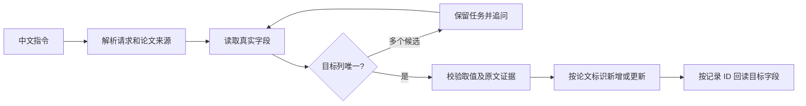

# 论文入表助手

用中文把论文存进飞书多维表格。助手先读取当前表的真实列名和类型，遇到两列都叫得通的情况会追问，写入后按记录 ID 回读。也可以使用内置的 SQLite 阅读清单体验完整对话。


## 运行

需要 Python 3.10 或以上。本地演示只使用 Python 标准库，无需 API Key。Windows 可以双击 `start.cmd`，也可以在项目目录运行：

```sh
python app.py --open
```

打开 **http://127.0.0.1:8765**。表格和下载缓存保存在 `data/`，关闭窗口后仍会保留。用 `python app.py --data-dir ./data/second-demo --port 8766 --open` 可另起一张空的本地演示表。

## 试用

| 在对话框中输入 | 可以看到的结果 |
| --- | --- |
| 把 https://arxiv.org/abs/2005.11401 存进阅读清单 | 表格新增一行，标题和链接写入相应列。 |
| 给刚才那篇补一句方法概述 | 只更新同一行的方法列，显示来源章节和原文短引。 |
| 把刚才那篇的方法写进笔记 | 助手列出“阅读笔记”和“研究笔记”。选择前不写入，选择后回读。 |
| 再存一次 https://arxiv.org/abs/2005.11401 | 提示相同内容已经存在，表内仍然只有一篇。 |
| 下载刚才那篇论文 | 提供来自官网的 PDF，可在浏览器保存。首次下载需要网络。 |
| 新建文本列 审阅意见 | 显示目标表和新列名，确认建列后才修改结构。 |

换一篇论文可以试“把 https://arxiv.org/abs/1706.03762 存进阅读清单”，再输入“给刚才那篇补英文原文摘要”。第一次使用新论文需要联网。普通网页链接可以作为 URL 收藏；arXiv 和 ACL Anthology 另支持题名、正文证据和 PDF 下载。

示例 RAG 论文的中文摘要和方法由作者预先对照原文整理，离线可用，界面会注明来源。其他论文从实际页面读取题名、作者摘要及可识别的方法段落。原文为英文时，可确认直接填写英文摘录，也可配置模型生成带原文短引的中文概述。方法章节缺失时，对应请求会说明缺少证据。若系统装有 Poppler 的 `pdftotext`，程序还会尝试读取 PDF 前 18 页，并记录匹配到的页码。[示例论文的原文](https://arxiv.org/html/2005.11401v4#S2)

## 连接自己的飞书测试表

在飞书多维表格里准备“论文标题”（文本）、“论文链接”（超链接）、“方法概述”（文本）等列。可再建两个含“笔记”的文本列体验歧义确认。在表中选中目标数据表后复制链接。两种身份任选其一。

**使用已经登录的飞书官方 CLI**

安装并授权支持 `api` 子命令的官方 CLI。在该身份能编辑的测试表上运行：

```sh
python tools/feishu_setup.py --mode cli
python app.py --mode feishu-cli --open
```

第一条命令会提示粘贴表链接。CLI 不在 PATH 时，将环境变量 `LARK_CLI` 指向真实可执行文件。Windows 可使用官方发布的 `lark-cli.exe`。需拥有目标多维表格、字段和记录的读取权限，新增和修改记录需相应写入权限，演示建列还需要字段创建权限。[飞书官方 CLI](https://github.com/larksuite/cli)

**使用自建应用**

在本机进程环境中设置 `FEISHU_APP_ID`、`FEISHU_APP_SECRET`。为应用开通所需多维表格 API 权限，发布生效并让调用身份获得目标表的编辑权。然后运行：

```sh
python tools/feishu_setup.py --mode app
python app.py --mode feishu --open
```

配置器把目标保存到忽略提交的 `data/feishu-target.json`。也可通过 `FEISHU_APP_TOKEN`、`FEISHU_TABLE_ID` 直接指定目标，设置 `FEISHU_TABLE_NAME` 可指定界面展示名。飞书模式的页面标记为“飞书多维表格”；鉴权失败会返回错误，不会把一次失败的远程操作记成本地成功。[开放平台新增记录接口](https://open.feishu.cn/document/server-docs/docs/bitable-v1/app-table-record/create)

## 可选语言模型

在进程环境中配置以下变量，重启服务即可使用兼容 Chat Completions 的接口。

| 变量 | 内容 |
| --- | --- |
| `PAPER_MODEL_URL` | 兼容服务的 HTTPS 接口，或本机模型的本地地址；可用以 `/v1` 结尾的地址或完整 `/chat/completions` 路径。 |
| `PAPER_MODEL_NAME` | 部署提供的模型名。 |
| `PAPER_MODEL_KEY` | 服务商密钥。本机免鉴权服务可以留空。 |

常见指令用本地规则识别。配置模型后，规则未识别的表达可交给模型生成限定结构的意图；程序会核对意图中的字段和字面笔记。生成中文摘要或方法时，只向配置的服务发送相关原文片段。模型给出的引用必须能在原文中逐字找到，界面把摘录和来源一起展示，便于人工判断概述是否准确。

## 实现和验证



- `workflow.py` 管理多轮状态、目标列选择和提交。每个浏览器会话有各自的待确认任务。
- `papers.py`、`pdf_sections.py` 处理论文链接、下载和证据。相同 arXiv 编号的不同版本默认归到同一篇文章。
- `table_store.py` 封装 SQLite、飞书应用和飞书 CLI 三种后端。更新时只提交本次要求的字段。业务查重处理重复指令，原生飞书新增请求使用持久化的幂等令牌处理传输重试。
- `model_support.py` 和 `intent_model.py` 为可选的模型提取及意图识别入口。飞书令牌和模型密钥留在服务端。

运行离线测试：

```sh
python -m unittest discover -s tests -v
```

测试覆盖字段歧义、确认和取消、同篇论文更新、模拟飞书回读及重试、模型输出校验，以及 HTTP 会话隔离。本工具面向单机演示和个人阅读清单，默认绑定本机回环地址。
